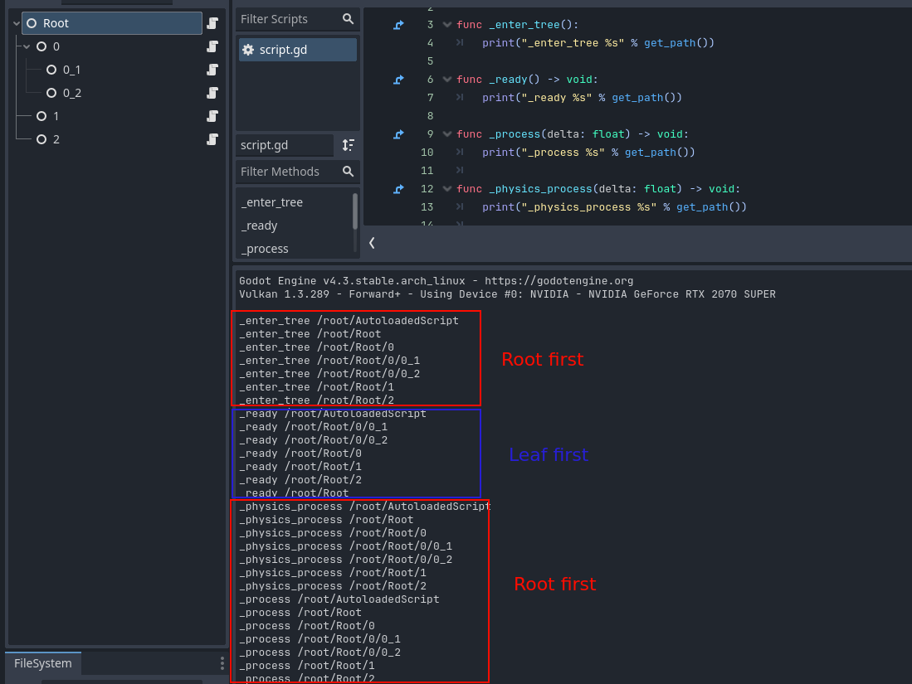

parentTopic:: [[Computer]]

# Scripting
## General
Every script is a class. 

To bind a script to a node in the scene, it has to inherit from `Node` class (or some more specific class like `RigidBody2D`). This is done with `extends Node` at the top of the file.

By default anything defined in one script is not visible in other scripts - enums, functions, the type itself, etc. To make it visible we have to put `class_name SomeName` at the top of the file. Then it will be visible as `SomeName` in all other scripts, no need to import. The class name doesn't have to be the same as the script name, but it can.

Nodes are deleted with `queue_free`, which queues the node for removal at the end of the frame. It will free all Node's children, remove the node from scene tree and free the node itself. Do not use `remove_child()`.


## Node callbacks
These callbacks are virtual methods defined in `Node` class and can be used in any script extending `Node`. The scene tree is traversed in DFS manner and all callbacks are called from root to leaves. This is sometimes called tree order or scene order in the docs. One exception is `_ready()` where it's from leaves to root, so the node's children are already initialized when executing. Autoloaded scripts are added to the root node and always called before all other nodes.

All implementable callbacks are listed [here](https://docs.godotengine.org/en/stable/classes/class_node.html#methods) with *virtual* keyword. List of the most useful callbacks:
- `_init()` - class constructor. Arguments for this function are passed to `Class.new()` invocation, making it a great initialization place for utility classes. In `Node` classes, however, it is a bit inconvenient. The engine sometimes calls the constructor without any arguments, so any params must have defaults.
- `_enter_tree` - called when adding Node to the scene. Godot state of the Node is already initialized here, but the children are not. So be careful, this one is still very early. It's better to use `_ready()` unless you're doing something funky.
- `_ready()` - typical init place. Called after the node entered the scene and all its children also executed `_ready()`.
- `_physics()` - called every frame, so as frequently as possible. Typically bound to vsync.
- `_physics_process()` - called with a fixed frequency, by default 60 times a second (there's a `physics/common/physics_ticks_per_second` project setting).


## Variable initialization
Variables defined outside any methods are not global variables! They are members of the current script class. They can be initialized in three ways:
- Inline. Be careful with this one - this initialization is very early - before adding to the scene tree and initializing children. Many Godot function will fail. Of course simple things like assigning a constant value will work.
    ```gdscript
    var myVar = 123
    ```
- In `_ready()`. This is called late enough, so that all Godot state is initialized and we can do everything
    ```gdscript
    var myVar
    
    func _ready():
        myVar = 123
    ```
- Inline with `@onready`. This is a nice way to keep definition and initialization in the same place and still defer initialization enough to have Godot state initialized. Be careful, do NOT use this with `@export`
    ```gdscript
    @onready var myVar = 123
    ```
- Inline with `@export`. This initializes variable the same as normal inline (so it is very early), but also shows the value in editor and allows to change it in scene view. The value is first initialized to the code value and then overriden with editor value, so if we call any functions to initialize it, they will always be called regardless of editor value. There are more specialized export annotations, like `@export_range`, see [docs](https://docs.godotengine.org/en/stable/tutorials/scripting/gdscript/gdscript_exports.html). Do NOT use this with `@onready`.
    ```gdscript
    @export myVar = 123
    ```


## Static/dynamic typing
Variables are statically typed when the type is defined at initialization and statically typed otherwise. It therefore is worth to always define a type, e.g with `:=` operator.
```gdscript
var a = 1        # No type defined
a = "123"        # OK

var b : int = 1  # Explicitly defined type
b = "123"        # ERROR

var c := 1       # Type inferred from initial value
c = "123"        # ERROR
```


## Globals, constants
There are two ways to make stuff globally accessible.
1. Create a script extending from `Node` and autoloading it - *Project -> Project Settings -> Globals -> Autoload*. An instance of the script is added to the tree and functions as a normal node - it can receive signals, callbacks, etc.
2. Create a script with `class_name` to make it globally visible and define constants or static variables and functions.
    ```gdscript
    class_name Globals

    static var myCounter := 0
    const verticesInTriangle := 3

    static func is_even(val : int) -> bool:
    	return (val % 2) == 0
    ```
 It is generally advised to use autoloads for stuff interacting with Godot because of freeing timings and better integration with the engine. Statics may be a more convenient choice for simple things like constants, enums and helper functions.


## Physics
RigidBodies:
- Do not move manually in `_physics_process()`. Assign to `state.transform` in `_integrate_forces()` callback.
- Do not set velocity manually. Use `apply_central_impulse()`
- Bodies can go to sleep as an engine optimization. When asleep, forces won't be calculated (and `_integrate_forces()` won't be called) until some other body hits the rigidbody and wakes it up. Disable sleeping whenever doing some physics scripting.
- Bodies slow down after each collision. By default `physics/2d/default_linear_damp = 0.1`.


## Instantiaing objects
All objects (either Godot-objects, nodes or custom classes) can be instantiated with `new()` function like below. Arguments given to `new()` will be passed to class's `_init()` constructor (see [[#Variable initialization]]).
```gdscript
var new := MyClass.new()
```

To instantiate a scene, first load it as a `PackedScene` object with either `load()` or `preload()`. Then use `PacketScene.instantiate()` to create a `Node` object. It can be casted to the type of actual root node of the scene. Remember to add it to scene tree with `add_child()`. Due to performance reasons, it's recommended to initialize all Godot state of the created node (e.g. position, rotation) before adding it to the scene tree.
```gdscript
const packed_scene := preload("res://SomeScene.tscn")

func _ready():
	var node := scene_preload.instantiate() as Node2D
	node.rotation = 45
	add_child(node)
```

`load()` vs `preload()`. The difference is a normal function `load()` and it loads the resource when it's called. However, `preload()` is special. It's actually a keyword, not a function and it's available only in GDscript. It loads the resource as soon as possible, i.e. when the script is loaded. The downside is it must be a path known at compile time (whereas `load()` can be dynamic).


## Export to executable
Open export dialog: **Project -> Export**.
Add a preset for desired platform (e.g. Windows Desktop).
Godot will complain about missing export templates. They can be downloaded automatically with the GUI or manually from the [download page](https://godotengine.org/download).


## Useful links
[All godot classes](https://docs.godotengine.org/en/stable/classes/index.html)
