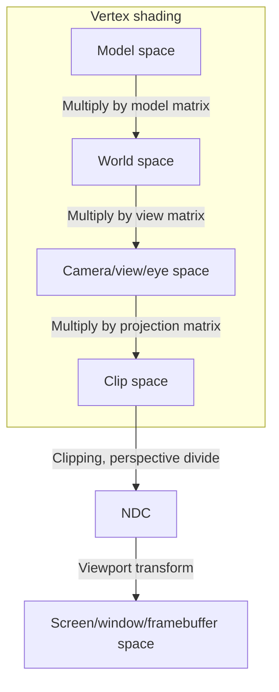

parentTopic:: [[Computer graphics]]

This information is gathered from various resources (LearnOpenGL, NVIDIA presentations, 3dgep, Johannes Unterguggenberger blog), which seem to agree upon most things. However, some of these terms are a bit loosely defined and they might be used in a different way. Especially ScratchPixel describes many things differently, e.g. screen space ranging from $-1$ to $1$ or perspective division by $z$ instead of $w$. It is still a good resource, but some aspects will not be defined in the same way as here.




## Model, world, camera spaces
These spaces are actually arbitrary when it comes to most graphics APIs. Matrix multiplications is performed in vertex shader to convert from model space to clip space, but we could as well specify clip space vertices in vertex buffer and have a passthrough vertex shader.

Model, view and projection matrices are usually multiplied together into MVP, so the shader can perform only one multiplication. Sometimes, however, individual matrices are still needed if it is needed to perform some calculations in intermediate spaces (e.g. to calculate world-space positions for calculating lighting).

When multiplying a 3D vector by projection (or MVP) matrix we have to append a fourth coordinate to the vector. For points (e.g. position) it should be $1.0$, whereas for directions (e.g. normal vector) it should be $0.0$ to avoid vector translation. Pseudo code:
```c
out_position = mvp * vec4(in_position, 1.0f);
out_normal = mvp * vec4(in_normal, 0.0f);
out_uv = in_uv;
```

See also: http://www.songho.ca/opengl/gl_projectionmatrix.html (maths for OpenGL projection matrix)

See also: https://johannesugb.github.io/gpu-programming/setting-up-a-proper-vulkan-projection-matrix/ (maths for Vulkan projection matrix)


## Clip space
Vertex shader is supposed to return clip space coordinates in graphics APIs. Vertices in clip space are 4D homogenous points (with additional $w$ coordinate). Clip space is defined as
$$
\begin{cases}
\begin{align}
    -w   &< x < w \\
    -w   &< y < w \\
    minZ &< z < w \\
\end{align}
\end{cases}
$$
where $minZ$ can be either $0$ or $-w$ depending on the API and configuration. See table below with differences of clip space between APIs:

| API     | Handedness   | x pointing | y pointing | z pointing | z range                                       |
| ------- | ------------ | ---------- | ---------- | ---------- | --------------------------------------------- |
| DirectX | left-handed  | right      | up         | away       | $0$ to $w$                                        |
| OpenGL  | left-handed  | right      | up         | away       | $-w$ to $w$ (can be changed with `glClipControl`) |
| Vulkan  | right-handed | right      | down       | away       | $0$ to $w$                                        |

Note that the clip space definition doesn't mean that triangles with vertices outside $<-1, 1>$ range will not be visible. All vertices may be beyond clip space, but the area of a triangle (interpolated positions) may still be visible.

The shape of the visible area in clip space is not defined and it depends on actual coordinates produced by projection. For perspective projection it will be a frustum and for orthographic projection it will be a cuboid.

After perspective projection $w_{clip}$ will be equal to $z_{view}$ to achieve the perspective effect after $w_{clip}$ division by hardware.


## Clipping
After vertex shading the GPU usually performs clipping. A common algorithm implemented in hardware is [SH clipping](https://en.wikipedia.org/wiki/Sutherland%E2%80%93Hodgman_algorithm).

Clipping is done before perspective division. This is because for negative homogeneous coordinates perspective division will flip $xyz$. This is mainly a problem for $z$ clipping, because vertices from behind the viewer ($z < -w$) will be moved farther than the far plane ($z > w$), so the geometry will be clipped by a wrong plane. There are, however, algorithms for clipping in NDC space (*Olano and Greer 1997*).

Because HW rasterizers usually just scan through pixels and check if they are contained in a polygon, clipping is not strictly neccessary. This is an expensive operation, so we'd like to avoid it. But it is still implemented, because there might be problems in rasterization for very high coordinate values (floating point precision, integer overflows). Usually a hybrid approach is used - guardband clipping. A guardband region is defined to be larger than the viewport. Only edges which are beyond the guardband region will be clipped. Edges which are outside the viewport, but still inside the guardband region will be kept to avoid expensive clipping work.
![[clipping.jpg]]
See also: https://fgiesen.wordpress.com/2011/07/05/a-trip-through-the-graphics-pipeline-2011-part-5/


## NDC
Clip space coordinates are divided by $w$ to convert to normalized device coordinates - NDC. Visible range in this space is from $-1$ to $1$ (sometimes from $0$ to $1$, see table in [[#Clip space]]). NDC space obviously has the same handedness and origin as clip space, it's only transformed around its origin. The shape of visible area in NDC space is a cube (or rather a cuboid if z ranges from $0$ to $1$).


## Viewport transform
Graphics APIs allows the user to define a viewport (e.g. `glViewport`, `glDepthRange`, `VkViewport`, `RSSetViewports`), which defines screen space boundaries for $x$, $y$ and $z$. They can have any values, but usually they are tied to screen/window resolution. NDC coordinates are linearly transformed to these ranges. Differences of screen space between graphics APIs:

| API     | Origin          | Pointing          | Handedness                            |
| ------- | --------------- | ----------------- | ------------------------------------- |
| Directx | left-upper-near | right, top, away  | right-handed (**different than NDC**) |
| OpenGL  | left-lower-near | right, down, away | left-handed                           |
| Vulkan  | left-upper-near | right, down, away | right-handed                          |
