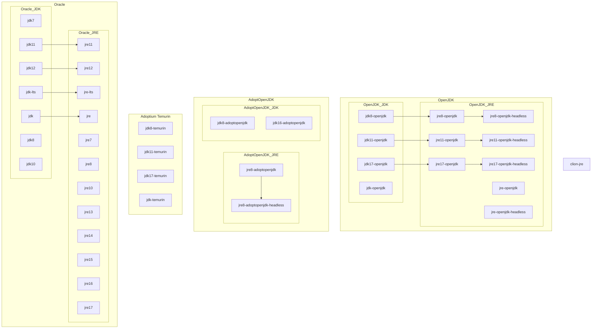

parentTopic:: [[Linux]]

Key concepts:
- JRE - Java runtime environment, required for running Java applications.
- JDK - Java development kit, required for creating Java applications.
- Headless JRE - JRE without the support of keyboard, mouse and display systems. Hence it has less dependencies and it makes it more suitable for server application. Some JRE packages depend on headless JRE, because they don't contain the code for core Java and some will conflict with it, because they already contain core Java.
- java-environment-common - common files for JDKs
- java-runtime-common - common files for JREs
- There are multiple implementations:
    - [OpenJDK](https://en.wikipedia.org/wiki/OpenJDK "wikipedia:OpenJDK") is an open-source implementation of the Java Platform, Standard Edition (Java SE), designated as the official reference implementation. AUR packages for building it from source: [jdk8-openjdk](https://archlinux.org/packages/jdk8-openjdk), [jdk11-openjdk](https://archlinux.org/packages/jdk11-openjdk), [jdk17-openjdk](https://archlinux.org/packages/jdk17-openjdk), [jdk-openjdk](https://archlinux.org/packages/jdk-openjdk)
    - AdoptOpenJDK/Adoptium/Temurin
        - prebuilt OpenJDK binaries maintained by community ([open source licensed](https://adoptopenjdk.net/about.html)). Transitioned to Eclipse Foundation, rebranded as Adoptium Temurin. Legacy packages: [jdk8-adoptopenjdk](https://aur.archlinux.org/packages/jdk8-adoptopenjdk/), [jre8-adoptopenjdk](https://aur.archlinux.org/packages/jre8-adoptopenjdk/).
        - Adoptium - working group at Eclipse Foundation. One of its subgroups is Temurin.
        - Temurin - group working on JDK and JRE. Packages: [jdk8-temurin](https://aur.archlinux.org/packages/jdk8-temurin/), [jdk11-temurin](https://aur.archlinux.org/packages/jdk11-temurin/), [jdk17-temurin](https://aur.archlinux.org/packages/jdk17-temurin/), [jdk-temurin](https://aur.archlinux.org/packages/jdk-temurin/).
    - Oracle JDK - Oracle's commercially licensed build of OpenJDK. Packages like: [jre](https://aur.archlinux.org/packages/jre/), [jre11](https://aur.archlinux.org/packages/jre11/), [jdk](https://aur.archlinux.org/packages/jdk/), [jdk11](https://aur.archlinux.org/packages/jdk11/).
    - clion-jre - clion doesn't have a dependency on it, but it makes STL containers be rendered correctly.
    - Others, e.g. OpenJ9, AzulJDK.
