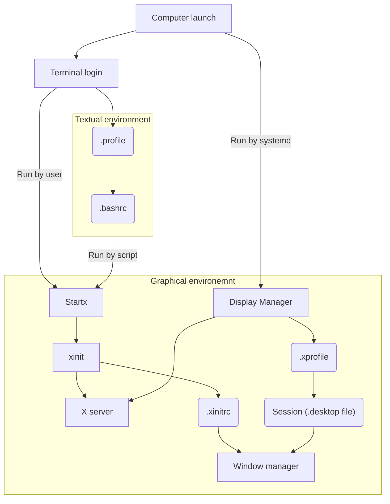

parentTopic:: [[Linux]]

# Xorg dotfiles

### Commands
xinit - executable binary which starts the X server and a window manager (rarely used directly)
startx - a frontend shell script to call xinit

### Dotfiles
- .xinitrc - configures X environment, runs background startup programs, runs main program (window manager)
- .xsession - similar to .xinitrc, used by display managers. Sometimes it may be necessary to create .xsession package just so the display manager calls our .xinitrc (see `xinit-xsession` package)
- .xprofile - similar to .xsession, used by different display managers
- .profile - setup not related to Xorg or any particular shell
- .bashrc - bash-specific setup (non login shells)
- .bash_profile - bash-specific setup (login shells)

### Other files
- Xsession files - .desktop files located in `/usr/share/xsessions/`.
- Xssesion scripts - in app specific directories, e.g. `/etc/lightdm/Xsession`.
